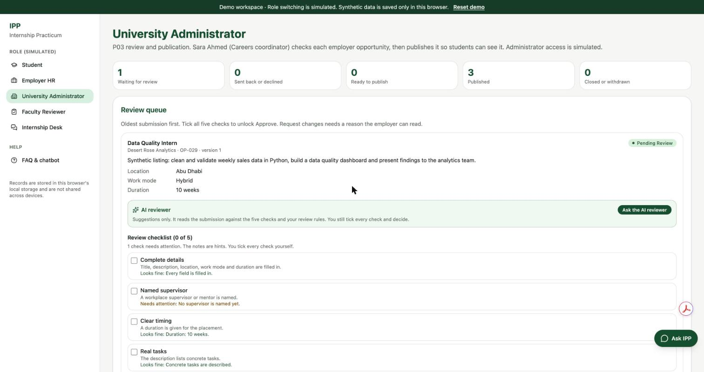
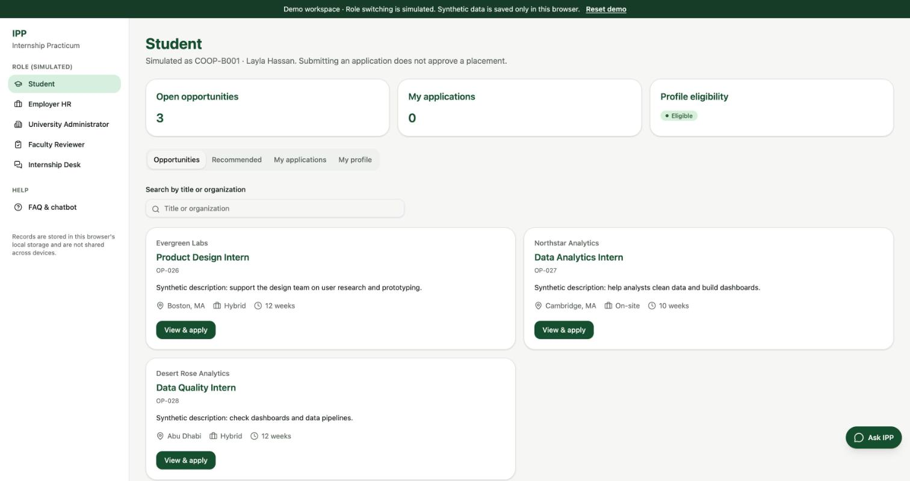
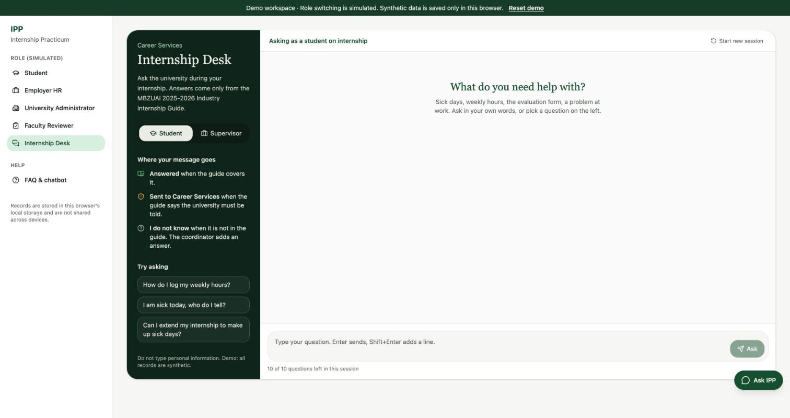

<div align="center">

# IPP: Internship Practicum Platform

**One shared app for the BUS 2010 Co-op project.** Employers post internships, the university reviews and publishes them, students apply, and everyone gets help from an AI desk during the internship.

[](https://github.com/ipp-coop-2026/ipp-coop/actions/workflows/ci.yml)
[](https://coh-ipp-coop-26b134973f81406a.cohesivity.workers.dev)


[Live demo](https://coh-ipp-coop-26b134973f81406a.cohesivity.workers.dev) · [Architecture](docs/ARCHITECTURE.md) · [Workflow and plan](docs/WORKFLOW.md) · [Contributing](CONTRIBUTING.md) · [Integration guide](INTEGRATION.md)



</div>

> **Demo data only.** Every person, organization and listing is synthetic. Role switching is simulated; there is no real login.

## What it does

The app follows one internship listing from start to finish, across the class teams' parts:

| Step | Who | Page | Owner |
| --- | --- | --- | --- |
| 1. Post an opportunity | Employer HR | `/employer` | P02 (Team 2), stand-in by Team 1 |
| 2. Review, approve and publish | University staff | `/admin` | **P03 (Team 3)** |
| 3. Find, get recommendations and apply | Student | `/student` | P01 (Team 1), P04, P05 |
| 4. See applications | Faculty reviewer | `/faculty` | To be decided at the Scrum of Scrums |
| 5. Get help during the internship | Student, supervisor, Career Services | `/desk` | **P03 (Team 3)** |
| Help and FAQ | Everyone | `/faq`, "Ask IPP" button | P01 (Team 1) |

### AI features

| Feature | What it does | Human in charge |
| --- | --- | --- |
| **AI reviewer** (`/admin`) | Reads an employer listing against the five review checks and the coordinator's own rules, then drafts a reason for the employer | The coordinator ticks every check and makes the decision; the decision log marks when an AI draft was used |
| **Internship Desk** (`/desk`) | Answers student and supervisor questions only from the MBZUAI 2025–2026 Industry Internship Guide, escalates urgent cases to Career Services, and records questions it cannot answer | Career Services resolves escalations and adds new guide entries |
| **FAQ chatbot** (`/faq`) | Answers from the approved FAQ and cites the entry it used | Anything outside the FAQ goes to the co-op office |
| **Recommendations** (`/student`) | Rules-based top three listings with reasons and gaps | A recommendation is never a placement |

Every AI feature falls back to a non-AI mode (guide matching, FAQ lookup, rule-based hints) when no model key is set on the host, so the demo always works.

<table>
<tr>
<td width="50%"></td>
<td width="50%"></td>
</tr>
<tr>
<td align="center">Student: published listings</td>
<td align="center">Internship Desk</td>
</tr>
</table>

## Quick start

```bash
npx -y bun@1.4.0 install --frozen-lockfile
npx -y bun@1.4.0 run dev      # http://localhost:8080
npx -y bun@1.4.0 run test     # 73 unit tests
npx -y bun@1.4.0 run build
```

Optional server-side keys (never in git; use `.env.local` locally or the host's settings):

| Variable | Turns on |
| --- | --- |
| `GROQ_API_KEY` | AI answers in the FAQ chatbot |
| `ANTHROPIC_API_KEY` | AI reviewer and AI answers in the Internship Desk |
| `DESK_REDIS_URL` | Desk cases shared across devices (otherwise kept in server memory) |

## Deploying

| Host | Command | Notes |
| --- | --- | --- |
| Cohesivity (shared demo) | `node deploy/cohesivity.mjs` | Needs a `.cohesivity` file (gitignored). See [INTEGRATION.md §12](INTEGRATION.md) |
| Render (Team 1) | [`render.yaml`](render.yaml) | Build: `NITRO_PRESET=node-server bun run build`; start: `node .output/server/index.mjs` |

## Project structure

```text
src/
  routes/            one file per page (/student, /employer, /admin, /faculty, /desk, /faq)
    api/             server routes: chat, ai-review, desk
  components/        AppShell, Internship Desk admin, shadcn/ui
  lib/
    ipp-store.ts     shared records and seed data (Team 1)
    ai/              FAQ chatbot and matching (Team 1)
    p03/             review, publication, AI reviewer and desk (Team 3)
  test/              vitest suites
deploy/              one-command Cohesivity hosting and runtime shims
docs/                requirements, data dictionary, decisions, test cases
sprint-1/, sprint-2/ sprint boards, feature briefs, Scrum of Scrums records
```

## Data

The demo keeps records in each browser (`localStorage`), so two devices do not see each other's changes yet. The class agreed on one shared Supabase database hosted by Team 5; the mapping from this app's records to its tables is in [INTEGRATION.md](INTEGRATION.md).

## Contributing

One repository, one app, one module per team ([architecture](docs/ARCHITECTURE.md)). Each team works on `p0X/...` branches and opens pull requests into `main`; CI and one approval are required ([workflow](docs/WORKFLOW.md)). Read [CONTRIBUTING.md](CONTRIBUTING.md) first. Never commit keys or real personal data (see [SECURITY.md](SECURITY.md)).

## Documents

| File | Contents |
| --- | --- |
| [docs/ARCHITECTURE.md](docs/ARCHITECTURE.md) | One app with a module per team, folder ownership, module rules, data migration path |
| [docs/WORKFLOW.md](docs/WORKFLOW.md) | Roles, branches, rules on `main`, releases, the phase plan to the final presentation |
| [INTEGRATION.md](INTEGRATION.md) | Team ownership, code map, shared-database mapping, deploy, merge order |
| [docs/requirements.md](docs/requirements.md) | Product goals, shortlist, traceability |
| [docs/data-dictionary.md](docs/data-dictionary.md) | Records, IDs, statuses, seed data |
| [docs/decisions.md](docs/decisions.md) | Decision log |
| [docs/test-cases.md](docs/test-cases.md) | Acceptance tests and results |
| [sprint-2/crisp-dm-mapping.md](sprint-2/crisp-dm-mapping.md) | CRISP-DM mapping for the AI features |

## Credits

Built by the BUS 2010 (Fall 2026) class teams at MBZUAI. The base app is Team 1's (P01); Team 3 (P03) added review and publication, the AI reviewer and the Internship Desk. Policy answers come from the MBZUAI 2025–2026 Industry Internship Guide.
