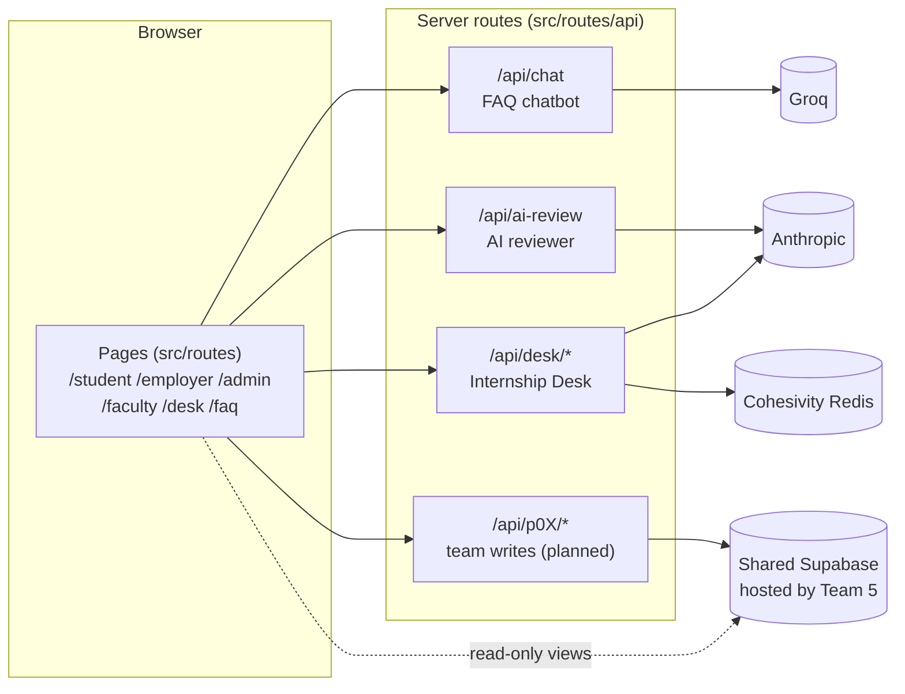

# Architecture

## Decision: one repository, one app, one module per team

The seven Co-op teams build **one deployable app in one repository**. Each team owns a module inside it. In other words, a modular app inside a monorepo.

| Option | Verdict | Why |
| --- | --- | --- |
| One app, one module per team (chosen) | ✅ | One look and one login flow (the Sprint 3 template asks us to "make your app look unified"), one deploy, one test run, shared records flow between parts |
| Workspaces with a separate app per team (`apps/p01`, `apps/p02`, ...) | ❌ | Seven deploys, seven styles, and data handoffs between apps; too much overhead for a class timeline |
| Separate repos linked together | ❌ | No shared review, no shared CI, the demo jumps between sites |

**Escape hatch.** A team whose prototype cannot be ported in time (for example a different stack) gets a nav entry that links to its own deployed site, marked "external". It is ported in later or stays linked for the final demo.

## System overview



- **Front end:** TanStack Start (React 19, TypeScript strict, Tailwind 4, shadcn/ui).
- **Server routes:** the only place model keys and team database keys are used. Nothing secret goes into the browser bundle.
- **Data today:** each browser's `localStorage` (Team 1's `ipp-store.ts`, plus P03's review layer under its own key).
- **Data target:** the shared Supabase database. Reads come from its public views; writes go through server routes that send the team's `x-team-key` header.
- **Hosting:** Cohesivity (shared demo, `node deploy/cohesivity.mjs`) and Render (Team 1, `render.yaml`). The same build serves both.

## Repository layout and ownership

```text
src/
  routes/                     pages, one file per URL
    student.tsx               P01 + P04 + P05 (tabs)
    employer.tsx              P02 (stand-in by Team 1)
    admin.tsx                 P03
    desk.tsx                  P03
    faculty.tsx               open (Scrum of Scrums)
    faq.tsx                   P01
    p0X.*.tsx                 new pages for a team, e.g. p06.prep.tsx -> /p06/prep
    api/                      server routes; new ones named p0X.*.ts
  lib/
    ipp-store.ts              SHARED CORE: records, IDs, seed data
    db/                       SHARED CORE (P05 leads): Supabase client and typed views (planned)
    ai/                       P01: FAQ chatbot, matching stand-in
    p03/                      P03: review, publication, AI reviewer, desk
    p0X/                      one folder per team: logic, with index.ts as its public API
  components/
    AppShell.tsx              SHARED CORE: layout and navigation
    ui/                       SHARED CORE: shadcn/ui primitives
    p0X/                      team components
  styles.css                  SHARED CORE: colours and tokens
  test/                       p0X-*.test.ts per team
deploy/                       SHARED CORE: hosting
docs/                         requirements, data dictionary, decisions, this file
sprint-N/                     sprint records
```

### Module rules

1. **A team writes in its own folders:** `src/lib/p0X/`, `src/components/p0X/`, `src/routes/p0X.*`, `src/routes/api/p0X.*`, `src/test/p0X-*`.
2. **Teams talk to each other only through public APIs.** Import another team's code only from `src/lib/p0Y/index.ts`, never from its internals. Shared records go through `ipp-store.ts` today and `src/lib/db/` later.
3. **Shared core changes need a maintainer review.** This covers `ipp-store.ts`, `db/`, `AppShell.tsx`, `ui/`, `styles.css`, `__root.tsx`, `package.json`, `bun.lock` and `deploy/`. Adding a nav entry is one line in `AppShell.tsx` in the same pull request.
4. **Environment variables** are prefixed by team (`P05_TEAM_KEY`, `P02_TEAM_KEY`). Shared ones (`ANTHROPIC_API_KEY`, `GROQ_API_KEY`, `DESK_REDIS_URL`) are set by maintainers on the host.
5. **Every AI feature has a non-AI fallback** and a named human who decides. The app never confirms a placement by itself.
6. **IDs and statuses follow the shared database** (`docs/data-dictionary.md`, INTEGRATION.md §7). Changing them needs Scrum of Scrums agreement, logged in `docs/decisions.md`.

## Data migration path

| Stage | Records live in | Who | Done when |
| --- | --- | --- | --- |
| 1. Now | Browser `localStorage` | All | Demo works on one device |
| 2. Read | Supabase views (`open_listings`, `current_profiles`, ...) through `src/lib/db/` | P05 builds the client; each team switches its reads | Pages show the shared database's records; local seeds dropped |
| 3. Write | Server routes `api/p0X.*` with the team key from the environment | Each team for its own tables | Changes made on one device show on every device |

When stage 2 lands, the P03 review layer moves to `listing_reviews` and `listings`, and the Internship Desk moves off Redis to a table that Team 5 approves.
