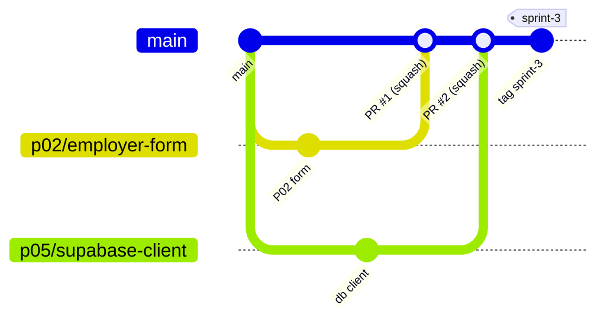

# Workflow: branches, reviews, releases and the plan

## Roles

| Role | Who | Can |
| --- | --- | --- |
| Org owner | Team 3 merge lead | Everything, including bypassing branch rules in an emergency |
| Maintainers (`@ipp-coop-2026/maintainers`) | One integrator each from Team 1 and Team 3, plus Team 7's product integration coordinator if they want it | Approve and merge pull requests, tag releases, deploy |
| Team integrators (`@ipp-coop-2026/p01-...` to `p07-...`) | One or two people per team | Push branches to this repo, open pull requests, review their own team's paths |
| Everyone else | Anyone with the link | Read, fork, open issues and pull requests from forks |

Ask the org owner in the cross-team Teams group to join your team's GitHub team. New members get read access to the org by default; write access comes from the team.

## Branches

| Branch | Use |
| --- | --- |
| `main` | Always working and always deployable. Protected (rules below) |
| `p0X/<short-topic>` | Team work, e.g. `p02/employer-form`, `p05/supabase-client`, `p03/decline` |
| `fix/<short-topic>` | A bug fix touching several teams |
| `core/<short-topic>` | Shared-core change (shell, store, styles, deploy) |

Keep branches short-lived (a few days). Rebase or merge `main` into yours before asking for review if it has fallen behind.

## Rules on `main` (enforced by GitHub)

- Changes only through a pull request.
- At least **1 approving review**, and all review threads resolved.
- The **CI check must pass**: type-check, tests and build (`.github/workflows/ci.yml`).
- New pushes to a pull request dismiss earlier approvals.
- No force-pushes and no deletion.
- Pull requests are **squash-merged**; the branch is deleted after merging.
- Only the org owner can bypass these rules, and only for an emergency fix.

`CODEOWNERS` routes each pull request to the team that owns the paths it touches, plus maintainers for shared core.

## Pull requests

1. One topic per pull request; small ones get reviewed faster.
2. Fill in the template: what changed, how to check it, the checklist.
3. Label it with your team (`P01 student` ... `P07 progress`) and a milestone (`Sprint 3`, `Final presentation`).
4. A reviewer from another team or a maintainer approves. Never approve your own pull request.

## Releases and deploys

| Event | Tag | Deploy |
| --- | --- | --- |
| Every merge to `main` | none | Maintainer redeploys the shared demo (`node deploy/cohesivity.mjs`) |
| Sprint 3 presentation | `sprint-3` | Frozen the evening before |
| Final presentation | `final` | Frozen the day before; AI switched on for the presentation only |

A **freeze** means only `fix/` pull requests are merged until the presentation is over.

## Plan

| Phase | Dates (2026) | Goal | Done when |
| --- | --- | --- | --- |
| 0. Onboard | 23–24 Nov | Every team has 1–2 integrators in its GitHub team and has posted its prototype link and stack in the merge-plan issue | Seven teams checked in |
| 1. Unify | by 26 Nov | Each team's part is either ported in as a module or linked from the nav as "external"; one look across pages | `sprint-3` tagged and deployed |
| 2. Read shared data | 28 Nov – 4 Dec | `src/lib/db/` (P05) reads Supabase views; each page switches from local seeds to shared records | Same records on every device |
| 3. Write and polish | by 6 Dec | Team writes go through server routes with team keys; stand-ins removed or accepted by their owners; end-to-end demo script rehearsed | `final` tagged; freeze |
| Final | from 7 Dec | Group project presentation | — |

The exam on Tue 1 Dec falls in phase 2; plan lighter work that week.

Progress is tracked in the pinned **merge plan** issue and on the milestones.
