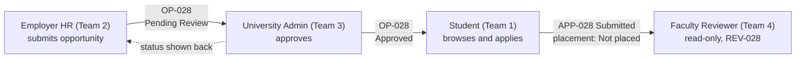

# IPP data dictionary v1.1 (Sprint 1)

**Status: v1.1, 7 Nov 2026.** Checked against the app on `main` (4f007a0) and the published link by the Team 1 data dictionary owner: every Student and Application field, ID rule and status matches the build. v1.1 only brings the text up to date with the build (eligibility values for Sprint 1, the Faculty record, prompt 07 done); no field name, ID format or status spelling changed. v1 was the draft for the Scrum of Scrums, 3 Nov 2026. The five common records and their fields come from the Lab 3 foundation prompt. Seed and demo records follow the group brief's shared thread (Layla Hassan COOP-B001, OP-028, APP-028), as the instructor decided on 3 Nov (D-05). Labels and layout follow the instructor's reference prototype. Items marked *(proposed)* need agreement from the instructor (lead PO) and the four teams. After that, only the Scrum of Scrums can change a shared field, and every change goes in [decisions.md](decisions.md).

All records are synthetic. No real student, employer or university data goes into the demo.

## Common records

Six records: Employer, Opportunity, Student, Application, Faculty and Faculty review.

### Employer

| Field | Type | Required | Rule or meaning | Example |
| --- | --- | --- | --- | --- |
| employer_id | text | yes | Unique, `EMP-###`, never reused | EMP-003 |
| organization_name | text | yes | Not blank or whitespace only. A submission for a new organization name creates a new employer *(proposed, Team 2 to confirm)* | Emirates Group |
| hr_user_id | text | yes | HR representative who submits for this employer, `HR-###` | HR-003 |
| hr_authorized | yes/no | yes | Sprint 1: set by the labelled "Simulate an authorized HR representative" control. Not real access control. | yes |

### Opportunity

| Field | Type | Required | Rule or meaning | Example |
| --- | --- | --- | --- | --- |
| opportunity_id | text | yes | Unique, generated, `OP-###` (group brief format). Seeds are OP-026 and OP-027, so the first live submission is OP-028 | OP-028 |
| employer_id | text | yes | Links to Employer; the screen shows that employer's organization_name | EMP-003 |
| title | text | yes | Not blank | Aviation Analytics Intern |
| description | text | yes | Not blank | Support route-performance dashboards for a network planning team |
| location | text | yes | Not blank | Dubai, UAE |
| work_mode | choice | yes | `On-site`, `Hybrid` or `Remote` | On-site |
| duration | text | yes | Free text in Sprint 1 | 12 weeks |
| approval_status | choice | yes | `Pending Review` or `Approved` in Sprint 1. New submissions start as Pending Review. | Pending Review |

### Student

| Field | Type | Required | Rule or meaning | Example |
| --- | --- | --- | --- | --- |
| student_id | text | yes | Unique, `COOP-B###` (group brief format). Read-only on screen. | COOP-B001 |
| display_name | text | yes | Not blank; the student can edit it (STU-04) | Layla Hassan |
| eligibility_status | choice | yes | Sprint 1: `Eligible` only, seeded and not checked. `Not eligible` and `Not verified` are planned values, added with real verification later (IPP-20). | Eligible |

### Application

| Field | Type | Required | Rule or meaning | Example |
| --- | --- | --- | --- | --- |
| application_id | text | yes | Unique, generated, `APP-###`, numbering starts at 028 so the first demo application is APP-028 | APP-028 |
| opportunity_id | text | yes | Links to an **Approved** opportunity only | OP-028 |
| student_id | text | yes | Links to Student | COOP-B001 |
| application_status | choice | yes | `Submitted` only in Sprint 1. Full path later: Draft → Submitted → Under Review → decision | Submitted |
| submitted_at | date-time | yes | ISO 8601; the build stores UTC (`Z`) and displays local time | 2026-11-10T06:15:00Z |

One application per student per opportunity: a second one for the same student_id + opportunity_id is blocked (STU-02, IPP-08).

### Faculty

| Field | Type | Required | Rule or meaning | Example |
| --- | --- | --- | --- | --- |
| faculty_id | text | yes | Unique, `FAC-###`. Sprint 1 has one seeded reviewer, and every review is assigned to FAC-001. | FAC-001 |
| display_name | text | yes | Not blank. Shown in the Faculty view header. Not editable in Sprint 1. | Synthetic Faculty Reviewer |

### Faculty review

| Field | Type | Required | Rule or meaning | Example |
| --- | --- | --- | --- | --- |
| review_id | text | yes | Unique, `REV-###`, one per application, numbering starts at 028 like applications | REV-028 |
| application_id | text | yes | Links to Application | APP-028 |
| faculty_id | text | yes | `FAC-###` | FAC-001 |
| review_status | choice | yes | `Available for review` only in Sprint 1 (faculty view is read-only). Created automatically when the application is submitted, as in the reference. | Available for review |

### Display-only value (not stored)

| Value | Rule |
| --- | --- |
| placement_status | Always shown as `Not placed` in Sprint 1, next to application_status and never merged with it. Placement decisions are deferred (IPP-22). |

## ID rules

- Three-digit, zero-padded, generated as the next unused number (`OP-028`, `EMP-003`). Applications and reviews start at 028 (`APP-028`, `REV-028`). Never reuse a number in the same dataset.
- Prefixes: `EMP-`, `HR-`, `OP-`, `COOP-B`, `APP-`, `REV-`, `FAC-`.
- Story IDs keep two digits (`EMP-01`, `FAC-01`) so they are not mistaken for record IDs (`EMP-001`, `FAC-001`).
- Use these exact field names and status spellings in every team's stories, prompts and tests.

## Status rules

| Record | Allowed change in Sprint 1 | Who | Blocked |
| --- | --- | --- | --- |
| Opportunity | (new) → Pending Review | Employer HR with simulated authorization on | Submission with authorization off |
| Opportunity | Pending Review → Approved | University Administrator | Students seeing Pending Review opportunities |
| Application | (new) → Submitted | Student, on an Approved opportunity | Duplicate application; applying to a Pending Review opportunity |
| Faculty review | (new) → Available for review | System, when the application is submitted | Any faculty edit (read-only in Sprint 1) |

Opportunity approval, application status and placement status are three separate things and are always shown separately.

## Seed data (Reset demo restores exactly this)

| Record | Seed (group brief thread, D-05) |
| --- | --- |
| Employer | EMP-001 Evergreen Labs, HR-001, authorized. EMP-002 Northstar Analytics, HR-002, authorized. |
| Opportunity | OP-026 Product Design Intern, EMP-001, Boston MA, Hybrid, 12 weeks, Approved. OP-027 Data Analytics Intern, EMP-002, Cambridge MA, On-site, 10 weeks, Approved. |
| Student | COOP-B001 Layla Hassan, Eligible (seeded) |
| Faculty | FAC-001, display_name "Synthetic Faculty Reviewer" (see the Faculty record above) |
| Application, review | none |

**Live demo record:** HR-003 submits **OP-028 "Aviation Analytics Intern"** for Emirates Group (the fictional classroom setting from the group brief), Dubai, On-site, 12 weeks → admin approves → Layla applies (**APP-028**) → faculty sees APP-028 / COOP-B001 / OP-028 with **REV-028**, Submitted, Not placed. Later snapshots from the brief (placement EG-DXB-028, skill SK-JIRA-01 with evidence E-JIRA-01) are not shown in Sprint 1.

## Workflow sketch

| Step | Screen | Reads | Creates or updates | Next role |
| --- | --- | --- | --- | --- |
| 1 | Employer HR: Submit an internship, Submitted opportunities | Employer | Employer (if new), Opportunity (Pending Review) | Admin |
| 2 | Admin: Review queue, Approved opportunities | Opportunity | Opportunity → Approved | Student, Employer HR |
| 3 | Student: Opportunities, My applications, My profile | Opportunity (Approved), Student | Application (Submitted), Faculty review (Available for review), Student.display_name | Faculty |
| 4 | Faculty: Applications (read-only) | Application, Student, Opportunity, Faculty review | nothing | - |

## Differences from the reference prototype

Seen in the reference on 3 Nov 2026. The master app follows the brief instead, and all five rows are now built that way (the seed row since prompt 07, a375503, 5 Nov):

| Reference | Brief / this dictionary | Owner |
| --- | --- | --- |
| Seeds Alex Lee STU-001 and OPP-001/OPP-002 | Layla Hassan COOP-B001, OP-026/OP-027, demo OP-028 (D-05; in the app since prompt 07, a375503) | Integrators |
| Opportunity stores `type` | Field is `work_mode` | Integrators |
| Opportunity stores `organization_name` directly; every new submission gets `employer_id` EMP-001 | Opportunity links to its own Employer via `employer_id` | Team 2 |
| No `hr_user_id` or `hr_authorized` stored; authorization is only a checkbox | Employer record carries both fields | Team 2 |
| Submission form has no work mode or duration inputs | STU-01 shows work mode and duration, so the HR form must capture them | Team 2 with Team 1 |

## Storage and limits (Sprint 1)

- Records are stored in the browser (local storage), so they survive role switches and reloads but are **not shared across users or devices**. The app says so in a persistent banner.
- Role switching and HR authorization are simulations and are labelled on screen.
- Real authentication (IPP-17), central storage (IPP-18), eligibility rules (IPP-20), faculty review outcomes (IPP-21) and placement decisions (IPP-22) are deferred.

## Later fields (not in Sprint 1)

The group brief's student profile handoff needs profile version, goals, availability, skill IDs, and evidence and review status (for example skill SK-JIRA-01 with evidence E-JIRA-01). Add these only through a Scrum of Scrums decision in a later sprint.
